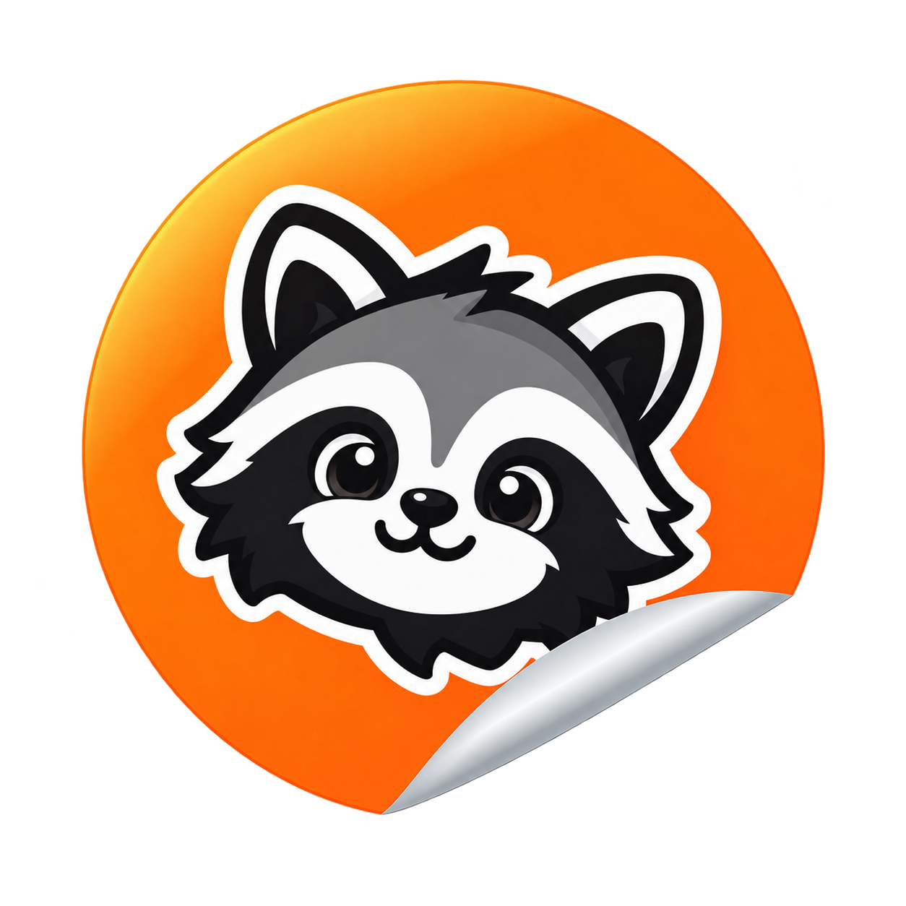
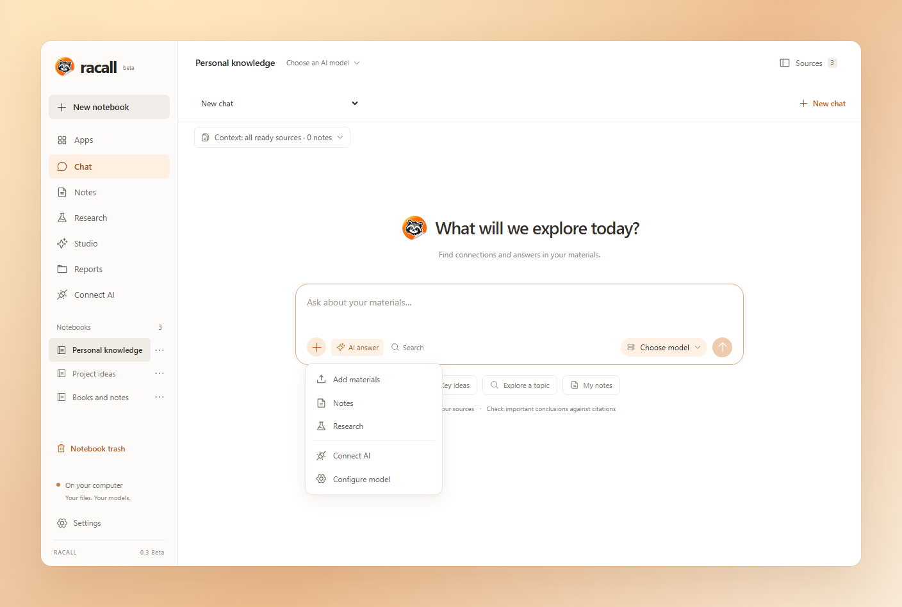

<p align="center">
  
  <picture>
    <source media="(prefers-color-scheme: dark)" srcset="assets/brand/wordmark-dark.svg" />
    
  </picture>
</p>

---

<h3 align="center">Racall is an open-source alternative to NotebookLM + Obsidian.</h3>
<p align="center">
  <a href="#features">Features</a> •
  <a href="#-get-started">Quickstart</a> •
  <a href="docs/GETTING_STARTED.md#first-notebook">Notebooks</a> •
  <a href="docs/README.md">Documentation</a>
</p>
<p align="center"></p>

## ⚡ Get started

**Racall 0.2 Beta is available for Windows.** Keep your sources, cited answers and connected notes in one desktop workspace.

| Platform | Link |
| :--- | :--- |
| **Windows x64 — 0.2 Beta** | [Download installer](https://github.com/SleepyCodeMeow/Racall/releases/download/v0.2.0-beta.1/Racall-0.2.0-beta.1-win-x64.exe) |
| **macOS / Linux — 0.2 Beta** | Not included in this release; platform testing and contributor help are welcome |

[Release notes](https://github.com/SleepyCodeMeow/Racall/releases/tag/v0.2.0-beta.1) · [SHA-256 checksums](https://github.com/SleepyCodeMeow/Racall/releases/download/v0.2.0-beta.1/SHA256SUMS.txt) · [Russian documentation](README.ru.md)

The Windows package includes its runtime: no Python, Node.js or Docker installation is required. Back up your knowledge folder with Racall closed before upgrading. The installer is unsigned.

Earlier **0.1 Beta** packages for Windows, macOS and Linux remain in the [previous release](https://github.com/SleepyCodeMeow/Racall/releases/tag/v0.1.0-beta.1). They do not contain the 0.2 changes. Mobile apps are planned for a later release.

1. Open Racall and create a notebook.
2. Open **Sources** and import a document.
3. Use **Search** immediately, or connect your model in **Settings** to ask questions.
4. Open a citation to inspect the passage, then capture your ideas in **Notes**.

English is the default interface language. Switch to Russian in **Settings → Interface language**. The compact Windows installer also offers a language choice and applies it on first launch. Later updates keep your saved preference.

## New in 0.2 Beta

- **Keep your work.** Saved chats with citation snapshots, note autosave and recoverable drafts.
- **Update your knowledge.** Replace source files, refresh websites and inspect the versions used by older citations. Rename notebooks or restore them from trash.
- **Choose your connection.** OpenAI, Claude, Ollama Local/Cloud and llama.cpp, with separate answer profiles and independent optional embeddings.
- **Make it yours.** Light, Dark and System appearance; a searchable model picker; confirmed local Ollama downloads with progress and cancellation.
- **Connect external tools.** Apps copies Ollama launch commands for tools such as Claude Code and Codex CLI. You choose when to run them in your terminal.

Read the [full changelog](CHANGELOG.md) and [0.2 release notes](docs/releases/0.2.0-beta.1.md).

## Features

| Bring your sources | Build your knowledge |
| :--- | :--- |
| Import text PDFs, Markdown, TXT and DOCX | Write portable Markdown with frontmatter and wikilinks |
| Save public HTML pages by URL | Ask questions with source citations |
| Search locally, with optional embeddings | Inspect exact passages and PDF page references |
| Keep originals on your computer | Run research across your notebook and save reports |

- **Your choice of AI.** Use OpenAI, Claude, Ollama Local/Cloud, llama.cpp or a custom OpenAI-compatible connection. Models need complete structured JSON output; model quality varies.
- **Local files you own.** Notes and originals remain on disk. Open a notebook folder as an Obsidian vault, or use another Markdown editor.
- **Evidence you can inspect.** Answers undergo citation validation and a separate model critique. AI review can still miss mistakes: follow the citations.
- **Connect your tools.** A read-only MCP server exposes one selected notebook to compatible desktop clients.
- **Useful without a model.** Import, browse, write notes and run text search without API access.

The screenshot shows the real interface with sample content. Its orange backdrop is presentation artwork; window controls follow your operating system.

## Your model, your data

In **Settings → AI connection**, save your provider, API URL, key and model. Profiles stay separate when switching providers. Use the model picker beside the message box to browse a saved connection. Local Ollama model downloads require explicit confirmation; opening or selecting a model starts neither a download nor a question. Embeddings are optional and configured separately. [Provider setup →](docs/PROVIDERS.md)

API keys use the operating system keychain. With a cloud provider, questions and retrieved passages are sent to that provider; cloud embeddings send the extracted document text. Local storage does not mean cloud inference stays on your machine.

Back up your knowledge folder with Racall closed. The exact location is shown in Settings; the legacy folder name `OpenNotebook` is kept for compatibility. [Data and backup guide →](docs/GETTING_STARTED.md#data-and-backups)

## What to expect from the beta

0.2 focuses on a more reliable desktop knowledge workflow. Chats are saved, but earlier messages are not yet supplied as conversational context to the model. Research is interrupted when the app closes and is not automatically replayed. Scanned PDFs need OCR elsewhere. Sync, mobile apps, graph view, presentations/audio generation and remote MCP/OAuth are not included yet.

The published Windows release passed **404 backend tests**, 374-key EN/RU checks, the full packaged regression suite and native installer language/install/uninstall checks on a disposable CI host. [Release-tag CI run →](https://github.com/SleepyCodeMeow/Racall/actions/runs/39257810891) These checks use deterministic provider fixtures; final live-provider acceptance and an owner's hands-on review were not performed. Current Linux/macOS desktop packages are not part of this release. [Verification scope and limitations →](docs/releases/0.2.0-beta.1.md)

## Built with

| Language | Responsibility |
| :--- | :--- |
| **Python** | Knowledge service, document ingestion, retrieval, citations, research, MCP and backend tests |
| **TypeScript** | React interface, typed API client and localization |
| **JavaScript** | Electron desktop integration and UI smoke tests |
| **CSS** | Interface layout and styling |
| **PowerShell / Shell** | Developer setup on Windows and macOS/Linux |
| **NSIS** | Windows installation and language handoff |

The GitHub Languages bar reflects source bytes, so its proportions change as the project grows. Generated bundles, dependencies and installers are not source files and are excluded from the repository.

## Development

Install Node.js 24, Python 3.12 and uv, then:

```sh
npm ci
uv sync --frozen
npm run dev
```

Developer setup helpers: `./scripts/setup.sh` on macOS/Linux, or `./scripts/setup.ps1` in PowerShell. They install this checkout's locked dependencies; they do not install system tools.

```sh
npm test -- -q
npm run lint
npm run test:i18n
npm run check:release
npm run build
npm run typecheck
npm run test:desktop
npm run dist
```

Python binaries are built on each target OS and architecture. [Contributing](CONTRIBUTING.md) · [Release process](docs/RELEASING.md) · [Architecture decisions](docs/adr)

The project is developed with assistance from OpenAI Codex. See the [code map](docs/CODE_MAP.md) for the files behind each feature.

## Follow the project

Everything lives on GitHub for now: [downloads](https://github.com/SleepyCodeMeow/Racall/releases), [documentation](docs/README.md), [bugs and ideas](https://github.com/SleepyCodeMeow/Racall/issues), and [the roadmap](docs/ROADMAP.md). Read [CHANGELOG.md](CHANGELOG.md) for each release. Trying the beta, reporting a reproducible bug, improving translations or helping with macOS/Linux testing are all useful contributions.

## License

Python core and tools: [Apache 2.0](LICENSE). Interface and desktop application: [AGPLv3](COPYING). Both allow commercial use and sale subject to their terms. [Component boundaries and contributor rights](LICENSING.md).

The already-published **0.1 Beta** source and downloads remain under their original MIT terms. The component licenses above apply to the current release as described in [LICENSING.md](LICENSING.md); earlier grants are preserved.

Racall is independently developed and is not affiliated with NotebookLM, Obsidian or Unsloth.
