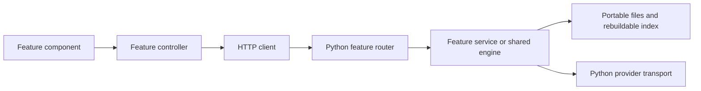

# A short tour for contributors

Start with [architecture](ARCHITECTURE.md) for responsibility boundaries and the
[code map](CODE_MAP.md) to locate a feature. This guide follows the application's
request path rather than listing every file.

## Start an isolated checkout

Install Python 3.12, Node.js 24 and uv, then run:

```sh
npm ci
uv sync --frozen
npm run dev
```

Point `OPENNOTEBOOK_DATA_DIR` at a disposable directory when experimenting with
storage. Keep private documents and API keys outside version control. The normal
application profile remains `OpenNotebook`; branding must not move user data.

## Follow a request



The chat composer calls `features/chat/use-chat.ts`. Its HTTP request reaches
Python's `features/chats/router.py`. Python validates context and owns retrieval,
writer/critic generation and persistence. React presents the result.

`Knowledge` is the stable entry point for routes, MCP and generation workers:

- `retrieval/service.py` selects evidence; `retrieval/ranking.py` implements rank
  fusion and cosine similarity.
- `generation/answers.py` bounds evidence, calls writer/critic and maps verified
  citation labels back to canonical source or note IDs.
- `generation/research.py` plans queries, retrieves evidence, revises an answer
  and saves an accepted Research finding.
- `features/jobs/service.py` owns the queue and final durable commit;
  `features/jobs/execution.py` computes output within that execution scope.

Document parsing lives in `documents/`. Strict JSON, SSE framing and Chat
Completions decoding live in `completion/`; HTTP lifetime and cancellation stay
in `completion_stream.py`. The native Messages state machine stays in
`anthropic_stream.py`.

## Find the right place to edit

| Change | Starting point | Existing check |
| --- | --- | --- |
| Navigation or pending edits | `features/workspace/use-workspace.ts` | persistence/maintenance desktop scenarios |
| Chat requests or transcript | `features/chat/use-chat.ts`, `chat-transcript.tsx` | chat/context tests, Studio desktop scenario |
| Source preview | `features/sources/use-source-detail.ts`, `source-document.tsx` | source/version tests, maintenance desktop scenario |
| Model discovery or downloads | Python `features/models/catalog.py`, `protocol.py`, `service.py` | model tests, workbench desktop scenario |
| Job cancellation or recovery | Python `features/jobs/service.py` | jobs and transport cancellation tests |
| Note frontmatter or revision | Python `features/notes/markdown.py` | note Markdown, persistence and context tests |
| Startup, trusted IPC or window | Electron `backend.cjs`, `security.cjs`, `native-actions.cjs`, `window.cjs` | native packaged scenarios |

Frontend paths are relative to `apps/web`; Python engine/feature paths are relative
to `apps/api/on_knowledge`; Electron modules live in `apps/desktop`. The
[code map](CODE_MAP.md) links directly to these files. The frontend public API
entry is `lib/api.ts`; transport and shared DTO types have separate modules.

## Keep a change reviewable

Use the existing router/schema/service/repository split where it helps. A short
cohesive module needs no empty layers. Separate rendering from long request or
lifecycle hooks, and name helpers after their responsibility. Avoid catch-all
utility files and broad rewrites bundled with a behavior fix.

```sh
npm run format
npm run format:check
npm test -- -q
npm run lint
npm run test:i18n
npm run check:release
npm run build:web
npm run typecheck
```

Ruff formats Python; pinned Prettier formats maintained JS/TS/CSS. `.editorconfig`
supplies editor defaults. Generated web output and test results are excluded.
Run a relevant `npm run test:...` desktop scenario after UI/lifecycle changes.
Scenarios use an isolated profile and synthetic model responses. Real-model
quality and native installed-package checks are separate from unit tests.

Treat API payloads, source IDs/versions, note revision hashes, storage paths,
credential scope and the final cancellation checkpoint as compatibility contracts.
Portable originals, Markdown and JSON remain authoritative; rebuilding SQLite
must not lose user knowledge.

Publication stays governed by `apps/shared/release.json`. A refactor does not
authorize a release or make older binary verification apply to new source code.
